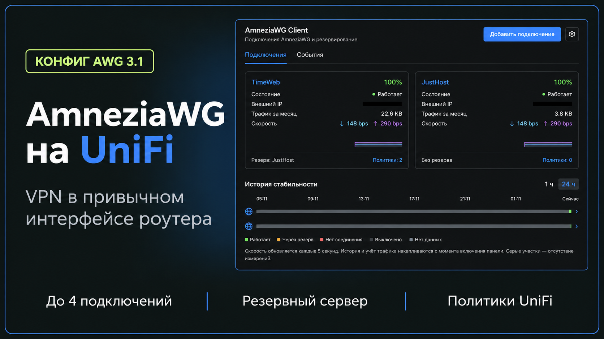

# AmneziaWG для UniFi

> **Добавлена поддержка UniFi OS 6.0.17 / UniFi Network 11.0.99.**

[Сайт проекта](https://djgreez.github.io/UniFi-AmneziaWG/) · [Как установить AmneziaWG на UniFi](https://djgreez.github.io/UniFi-AmneziaWG/installation/) · [Как работает](https://djgreez.github.io/UniFi-AmneziaWG/architecture/) · [English setup guide](https://djgreez.github.io/UniFi-AmneziaWG/en/installation/)

AmneziaWG в штатном интерфейсе UDR7/UDM/UDM Pro/UDM SE итд. Можно добавить до четырёх подключений, назначить каждому свои политики UniFi и выбрать резервный сервер. В панели есть статистика, история доступности и события переключения.

> **Требуется конфигурация AmneziaWG 3.1 в нативном формате `.conf`.** Версия интеграции UniFi-AmneziaWG — **0.3.3**; это отдельный номер версии. При подготовке конфига проверьте, что сервер и экспортируемый клиентский конфиг используют AWG 3.1.



[Исходный скриншот панели](docs/assets/panel.png)

При добавлении AWG-конфига автоматически создаётся локальный WireGuard-профиль в UniFi. Выбирайте его в обычных политиках маршрутизации. При переходе на резерв политики менять не нужно.

> Проект тестовый и не связан с Ubiquiti. Всё на свой страх и риск: установка меняет файлы UniFi. Сохраните резервную копию и оставьте себе доступ к роутеру по SSH.

## Проверено на:

| Устройство | UniFi OS | UniFi Network |
| --- | --- | --- |
| **UDR7** | **5.1.34+** | **10.6.109+** |
| **UDM** | **5.1.33+** | **10.6.101+** |
| **UDM Pro** | **5.1.34+** | **10.6.109+** |
| **UDM** | **6.0.17** | **11.0.99** |

Минимум: ARM64, UniFi OS **5.1.33** и Network **10.6.101**. Верхнего ограничения по версии нет: установщик выбирает способ интеграции для Network 10 или 11 и проверяет структуру файлов интерфейса. Более новые версии допускаются, но их совместимость не гарантируется.

> **Автоматические обновления UniFi OS и UniFi Network не тестировались. Обновляться не рекомендуется.** Перед использованием отключите автоматическое обновление обеих систем. Сохранность интеграции, работа туннеля и удаление после обновления не гарантируются.

## Установка

Подключитесь к роутеру по SSH от `root` и выполните команду на нём:

```sh
curl -fsSL https://raw.githubusercontent.com/DjGreeZ/UniFi-AmneziaWG/v0.3.3/install.sh -o /tmp/awg-install.sh && sh /tmp/awg-install.sh
```

В `/data/awg-native` устанавливаются движки AWG, панель, службы запуска и восстановления. Оригинальные файлы интерфейса сохраняются для удаления. Компилировать ничего не нужно.

**Обновление с 0.3.x:** повторите команду установки. Подключения, ключи и настройки сохранятся.

**Переход с 0.2.x:** автоматического переноса подключений нет. Сохраните исходные AWG-конфиги, удалите старую интеграцию через `uninstall.sh --purge` и связанные VPN-профили и политики UniFi. Затем установите 0.3.3 и добавьте подключения заново.

## Использование

1. Откройте UniFi по локальному IP роутера. Через `unifi.ui.com` наше меню не отображается.
2. Перейдите в **Settings → VPN → AmneziaWG Client**, нажмите **Добавить подключение** и загрузите нативный `.conf` **AmneziaWG 3.1**.
3. В политиках UniFi выберите созданное подключение и включите **Kill Switch**.
4. Если нужен резерв, добавьте ещё одно подключение и выберите его в настройках основного.

Шестерёнка рядом с добавлением открывает настройки внешнего доступа: отдельный пароль и список разрешённых IP/подсетей. По умолчанию он выключен. Открывается только AWG-панель; для доступа извне нужен доступный адрес и порт. HTTPS использует самоподписанный сертификат.

DNS для устройств задаётся в UniFi; из AWG-файла он в LAN не переносится. Проверка связи использует `1.1.1.1` — этот адрес должен входить в `AllowedIPs`. IPv6 через VPN не поддерживается.

## Удаление

Сначала удалите или перенастройте связанные политики и VPN-профили в UniFi. Команды ниже выполняются по SSH на роутере от `root`.

```sh
sh /data/awg-native/uninstall.sh
```

Конфиги и ключи останутся. Для полного удаления:

```sh
sh /data/awg-native/uninstall.sh --purge
```

После удаления обновите страницу.

Код, исходники движков и лицензии — в архиве `AmneziaWG-UniFi-v0.3.3-source.tar.gz` на [странице релиза](https://github.com/DjGreeZ/UniFi-AmneziaWG/releases/tag/v0.3.3).
